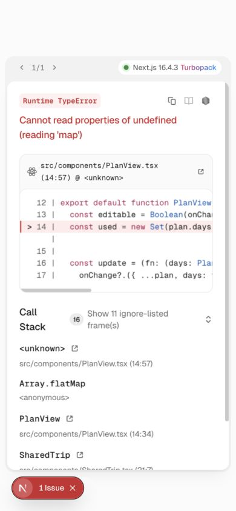
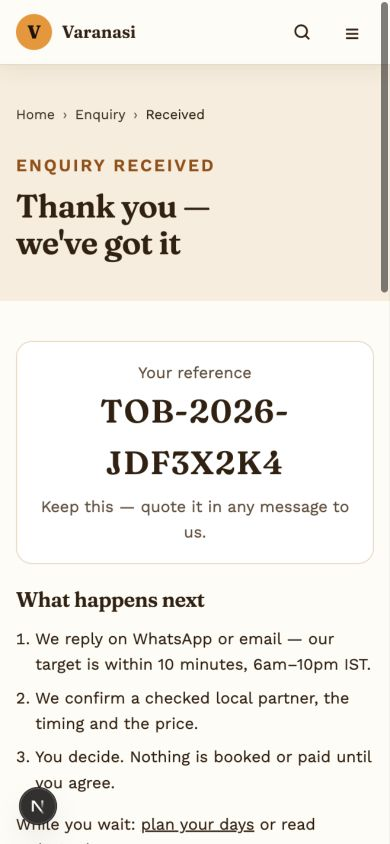

# Travel Buddy — functional QA and gap review

Date: 1 November 2026 (IST). Scope: current uncommitted repository, not a deployed production release.

## Assessment

**Not ready to claim completion of the agreed full-stack Next.js/MySQL plan.** The public site is Next.js, but staff screens remain Vite/React Router and the backend remains Express/SQLite. Core discovery, enquiries and the blog workflow work. Booking confirmation safeguards, input validation, shared-plan robustness and several agreed operational modules need work.

This was an audit. Application source was not fixed or migrated during testing. Changes from this audit are the files in `qa/`; builds also generated their normal ignored output. Existing development work was preserved.

## Environment and evidence

- Public app: Next.js 16.4.3, React 19.3.0, TypeScript, port 3200.
- Admin/author app: existing React/Vite app, port 5273, hash routes.
- API: copied current `server/src` into `/tmp/travel-buddy-qa/server`, with a fresh SQLite database and synthetic users, port 4100.
- The user's existing services on 3100/4000 were not used for write tests. No real customer data or staff accounts were modified. SMTP/WhatsApp credentials were not copied or configured in the test server.
- Production builds passed for Next.js and Vite. Next.js build completed TypeScript checking and generated 206 static build entries. The route inventory excludes internal error routes; 203 generated public/resource paths were used as crawl seeds.
- Next.js ESLint passed. Root Oxlint passed with warnings, including unused imports and React fast-refresh rules applied to Next.js page exports. Vite warned about its 1.60 MB main JS bundle (~447 KB gzip); Next.js warned about inferred workspace root and multiple lockfiles.
- API suites: **145 checks, 136 PASS, 9 FAIL**. See `api-results.json`, `extended-results.json`, `legacy-results.json`.
- HTTP page sweep: **220 unique URLs, 212 HTTP 200, 8 HTTP 404**. This includes **208 HTML pages** and resource endpoints. See `PAGE_INVENTORY.md` and `page-results.json`.
- The eight 404s are deliberate probes: `/admin`, `/admin/login`, `/author`, `/contact`, `/booking`, `/index.html`, `/not-a-real-page`, `/places/temples/not-a-place`. `/about/contact` and `/enquiry` work; `/contact` alone is not an observed broken internal link. The unknown-page probes correctly return 404. Admin/author 404s demonstrate that these roles have not been migrated onto Next.js. `/index.html` demonstrates missing legacy redirect support.
- Browser checks used Chrome plus the in-app browser, including a 390×844 mobile viewport. All 10 admin destinations plus dashboard rendered. Four mobile staff screens measured 390px document width at a 390px viewport.
- HTTP status checks are **not** exhaustive interaction, accessibility or device certification. The full inventory and coverage boundaries below are part of the result.

## Confirmed defects

### QA-01 — P1: Booking requests can be confirmed without the required checks

**Reproduction:** Create a fresh lead. PATCH `/api/admin/leads/<reference>` with `{"status":"confirmed"}`. It returns 200 even without an assigned supplier, quote or recorded customer acceptance. Assign a supplier with `partnerResponse: "declined"`, then confirm: also 200.

**Impact:** Staff can communicate a confirmation that has not been accepted by the supplier/customer. The database has no quote or acceptance record supporting the agreed workflow.

**Recommendation:** Introduce a transition service, quote snapshots, explicit customer acceptance and supplier acceptance prerequisites. Record all transitions transactionally and reject unsupported transitions with 409. Preserve an audited override path only if the business explicitly needs one.

**Evidence:** `extended-results.json`, checks “Confirm fresh request requires supplier and customer acceptance” and “Declined supplier cannot be confirmed”; `server/src/routes/admin/leads.js:136`.

### QA-02 — P2: Completed bookings can be reset to new

**Reproduction:** Complete a lead with value/commission, then PATCH `{"status":"new"}`. Returns 200, retaining old confirmation and response timestamps.

**Impact:** Invalid state history and misleading operational metrics. Status validation checks membership, not the allowed previous-to-next transition.

**Recommendation:** Define explicit state transitions, terminal states and a reasoned/audited reopen operation. Reset or version timing metrics deliberately on reopen.

**Evidence:** `api-results.json`; `server/src/routes/admin/leads.js:136`.

### QA-03 — P2: Duplicate enquiry submissions create separate records

**Reproduction:** POST the identical valid `/api/leads` payload twice immediately. Both return 201 with different references.

**Impact:** Retries after a network timeout can create duplicate customer enquiries. Disabling the submit button does not protect network retry or multiple tabs.

**Recommendation:** Issue an idempotency key per form submission; persist a unique key and response reference in the same transaction as the lead and its initial history entry. Retry returns the original receipt.

**Evidence:** `api-results.json`; `server/src/routes/leads.js:65` and `web/src/components/EnquiryForm.tsx:88`.

### QA-04 — P2: Invalid dates and traveller counts are persisted

**Reproduction:** Submit arrival `2026-02-30`: 201. Submit `travellers: -2`: 201; the API silently clamps it to 1.

**Impact:** Operational staff receive impossible dates and altered traveller counts instead of the visitor correcting the request.

**Recommendation:** Shared schema validation with real calendar-date round trips, explicit positive integer range checks and clear field errors. Define past-date and same-day policies by enquiry type. Do not silently change a user's group size.

**Evidence:** two failures in `api-results.json`; `server/src/middleware/validate.js:22`; `server/src/routes/leads.js:63`.

### QA-05 — P2: Malformed shared itineraries crash the page

**Reproduction:** Open `/plan/trip?d=eyJkYXlzIjpbe31dfQ`. The payload is `{"days":[{}]}`. The decoder accepts it because `days` is an array. After hydration `PlanView` calls `d.items.map` on undefined. Browser shows a Runtime TypeError.

**Impact:** A malformed shared link breaks the complete page instead of showing the existing invalid-plan message. Server HTML/status checks alone do not catch it.

**Recommendation:** Validate the complete shared-plan schema, array limits, activity fields, allowed link protocols and input enums before rendering. Validate saved localStorage data too, version the payload and add an error boundary. Bound payload size.

**Evidence:** `browser-results.json`, `malformed-shared-plan.png`; `web/src/lib/planner.ts:202`, `web/src/components/PlanView.tsx:14`.

### QA-06 — P2: Malformed blog fields cause HTTP 500

**Reproduction:** As the owner of an editable revision, PUT `{"coverUrl":{"invalid":true}}` to `/api/editorial/revisions/<id>`. `cleanEdit` calls `.trim()` on an object and returns a generic 500.

**Recommendation:** Validate the entire body before normalization, including nullable string fields, category, dates and sources. Return 400 for invalid types and add table-driven malformed-input tests.

**Evidence:** `api-results.json`; `server/src/blog/content.js:137`.

### QA-07 — P2: Hero uploads accept fake images

**Reproduction:** Upload a text Blob named `fake.png` with declared MIME type `image/png` to `/api/admin/hero-slides`. It returns 201. The equivalent editorial image upload correctly rejects this input.

**Impact:** Invalid assets can enter the homepage gallery. This test establishes missing file-content validation; it does not establish executable code execution.

**Recommendation:** Reuse common image validation for hero/blog/profile uploads, decode and re-encode images, enforce dimensions and limits, and remove rejected files.

**Evidence:** `extended-results.json`; `server/src/uploads.js:31`, `server/src/routes/admin/heroSlides.js:47`. Test upload removed from the isolated database afterward.

### QA-08 — P2: Analytics accepts personal-data properties

**Reproduction:** POST an allowed event with `props: {email: "synthetic@qa.invalid", phone: "9876543210", name: "Synthetic QA"}`. Returns 204 and stores all three fields. Verified directly in the isolated database.

**Impact:** The endpoint does not enforce its documented “no personal data” contract. This is a data-minimization defect, not evidence that the normal client currently sends those fields.

**Recommendation:** Allow-list property names and types per event; sanitize path/referrer/UTM fields; apply retention and consent behavior consistently. Test forbidden fields at the persistence boundary.

**Evidence:** `extended-results.json`; `server/src/routes/events.js:19`.

## Requirements and launch gaps

| Priority | Gap | Evidence and recommended next step |
|---|---|---|
| P1 | Full-stack Next.js migration incomplete | `web/` hosts public pages; `src/main.jsx` still defines admin/author hash routes; `server/src/app.js` still hosts Express APIs. Migrate server-only services/Route Handlers and staff layouts before removing the legacy apps. |
| P1 | MySQL/Prisma not implemented | `server/src/db.js:1` imports `node:sqlite`; no MySQL/Prisma dependency/schema. Add MySQL schema/migrations and rehearse data import with ID/hash/reference preservation and rollback. |
| P1 | Secure customer booking tracking absent | A reference receipt exists but no private status/quote/confirmation screen or verified access flow. Add short-lived private links or verified access. A reference alone must never grant access to customer data. |
| P1 | Durable notification delivery absent | `server/src/notify.js:105` starts fire-and-forget sends with logging; no durable jobs, retries or delivery queue UI. Use a transactional outbox and worker before making dependable delivery claims. Real external delivery was not tested. |
| P1 | General destination CMS absent | Most destination content lives in TypeScript/Markdown under `web/src/content` and `web/content`; the blog has a real workflow. Add CMS modules for places, experiences, services, festivals, navigation and verification. |
| P1 | Supplier verification is not a managed evidence workflow | Public experience status is hardcoded onboarding; leads have supplier names/free text. Add supplier records with evidence, reviewer, scope, expiry, suspension and protected documents before confirmed verified-provider claims. |
| P1 | Legal/business details and content verification unfinished | Legal pages show draft placeholders. 169 successful crawl responses are noindex, largely intentionally under-review destination/experience content. Complete review rather than removing noindex blindly; do not call these pages publication-ready. |
| P2 | Contact management incomplete | General messages persist as leads, but no dedicated subject field or New/In progress/Resolved/Spam inbox with separate internal notes and assignment. Reuse a shared enquiry core with clear message categories. |
| P2 | Booking details incomplete | Request form has generic arrival/departure/travellers; no preferred service time, adult/child split, structured pickup/accessibility details, immutable offering snapshot or quote/customer acceptance records. |
| P2 | Staff dashboard incomplete | It shows lead/response/alert metrics, but lacks unified pending editorial approvals, failed notifications, contact assignments and overdue content verification queues. |
| P2 | Universal audit trail absent | Blog review and lead status history exist. Role changes log to console; no general append-only audit history for roles, supplier verification, media and administrative changes. |
| P2 | Legacy redirects absent | `/index.html` returns 404 on Next.js. Add tested mappings for legacy HTML paths and a browser-side hash-link compatibility landing page. |
| P2 | Production environment defaults remain local | `web/src/lib/site.ts:4/9` defaults canonical/API URLs to localhost; compose also defaults to local public URLs. Validate required production values or move browser API calls to same-origin handlers. |
| P2 | Password recovery requires an operator | Forgot-password returns a generic operator-contact message; no expiring reset-link email flow. Add a tested recovery process before onboarding nontechnical writers. Enumeration resistance already passed. |
| P2 | Backup restore is not verified | Guidance exists but there is no demonstrated automated MySQL/media backup or restore run. Validate recoverability after the actual MySQL migration. |
| P2 | Alerts can become stale in an already-open page | Alert components fetch once at mount, without expiry timers/revalidation. Server filtering is present; add client refresh/expiry behavior and connectivity/freshness indicators. This is a source-review finding, not a timed browser reproduction. |
| Later | Phase 2/future scope | Device-local saved trips/share links already exist. Favourites, account sync, partner dashboard, completed-booking reviews, reviewed Hindi publishing, payments/refunds and Next.js offline support remain unimplemented. Keep these separate from MVP fixes. |

## Functional coverage

### Public

| Area | Tested | Outcome |
|---|---|---|
| All generated content routes and discovered internal page links | HTTP, title, H1 count, canonical/robots collection; unknown-route responses | 212 successful responses; inventory attached. No 500/application-error HTML in the crawl. Synthetic blog fixtures deliberately contained H1 headings, so their multiple-H1 warnings are fixture content, not new route defects. RSS is XML and intentionally has no H1. |
| Contact | Empty form errors/focus, valid submission, reference receipt, database-backed admin visibility | PASS |
| Experience enquiry | CTA preserves experience/type; valid submission; receipt | PASS. Rate limit was reached during testing and its error displayed correctly; restarted only the isolated API before completing this check. |
| Search | Sarnath produces 19 results; unmatched query has fallback contact action | PASS |
| Places | Temple filter produces 8 of 36 places; unmatched text produces 0 of 36 | PASS |
| Planner | Senior/low-walking generation, reorder, remove, add, save, share/view, saved-list persistence, deletion | PASS for exercised paths; malformed shared payload FAIL |
| Mobile navigation | 390px menu open/close with Escape; search page document width | PASS; no horizontal page overflow observed |
| Blog | Published article, author link, source section, verified date; API tag/search filtering; category/author/tag/detail routes | PASS for fixtures |
| Travel alerts | Create/read/delete via API; empty state clearly avoids guaranteeing normal conditions | PASS |
| SEO/legal | Metadata capture, sitemap/robots/feed endpoints, under-review noindex behavior, legal draft display | Render behavior works; readiness gaps above |

### Admin and author

All existing admin screens opened without visible error: Dashboard, Leads, Travel Alerts, Blog, Hero Photos, Buddy Applications, Plan Requests, Buddies, Stories, Users, My author profile. Editor/revision page also rendered and was exercised. Mobile width checks covered Leads, Blog, Users and Blog Editor.

| Function | Outcome |
|---|---|
| Login, bad-password denial, logout/session clearing, password-change revocation | PASS |
| Anonymous/user/author/editor restrictions; public signup role escalation blocked | PASS |
| Role grant, immediate demotion enforcement, own-role change blocked | PASS |
| Author own-draft isolation; other author cannot view/edit | PASS |
| Draft creation, incomplete submission rejection, rich/Markdown conversion, save, submit/read-only state | PASS |
| Review, fact check, source/date requirements, changes requested/comments | PASS |
| Separate-admin approval, contributor self-approval denial, locked approved content | PASS |
| Publish/read, new draft while live version stays public, slug lock, archive/unarchive | PASS via API, plus public browser verification |
| Schedule/unschedule, execute due publication, reject stale verification at execution | PASS; used controlled future time against isolated fixtures |
| Revision restore creates draft; duplicate open revision rejected | PASS |
| Author profile update/public page | PASS |
| Real editorial image upload / fake image rejection | PASS |
| Hero upload/focal position/reorder/delete | PASS after correcting test to use the existing PUT contract; fake-image protection FAIL |
| Buddy/story create/update/delete | PASS |
| Buddy application submission/detail/approval/filter/rejection | PASS |
| Legacy trip request submission/list/status | PASS |
| Lead create/list/history, assignment, partner response, completion validation | Basic workflow PASS; confirmation and state-transition defects above |
| Final browser-native publication confirmation | INCOMPLETE in Chrome automation: native `window.confirm` stalled the browser control. API publication passed, and the resulting public article was verified in the in-app browser. Do not count the final native confirmation click as a browser pass. |

## Not certified by this run

- Real SMTP/WhatsApp transmission, retries or customer receipt; external messages were intentionally disabled in the isolated environment.
- End-to-end MySQL persistence, transactions, migrations, backup restore or unified Next.js backend: these implementations do not exist yet.
- Live supplier availability, operational facts, emergency numbers, actual travel conditions, historical claims or publication sources. No destination fact research was performed in this software QA run.
- Complete manual WCAG/screen-reader audit, every keyboard interaction, all rich-editor toolbar combinations, browser upload picker behavior, drag/drop, printing, clipboard permissions or every device/browser. API image validation and selected editor interactions were tested.
- Load/concurrency, production HTTPS/cookie/proxy behavior, security penetration testing or payment processing.
- Required failure/recovery tests for outage, disk exhaustion, worker crashes, notification retries and restore; add these after the relevant infrastructure exists.

## Recommended repair order

1. Add the booking transition/confirmation rules and quote/acceptance model. Fix date/count validation and idempotency together at the service/database boundary.
2. Fix the shared-plan schema crash, malformed blog field handling, hero file validation and analytics property allow-list. Turn the reproductions into focused regression tests.
3. Complete Next.js staff/API consolidation and MySQL/Prisma migration with contract tests and rehearsed rollback. Do not discard working blog authorization rules during the port.
4. Add durable notification jobs, secure booking tracking, contact inbox, supplier verification records and a general audit trail.
5. Finish CMS-backed destination management, content verification and business/legal details. Add legacy redirects, production configuration validation and measured mobile/performance budgets.
6. Run a release suite in CI: build/type/lint, route inventory, API/DB integration, author-to-admin publication E2E, booking E2E, mobile browser checks and backup/restore verification. Add Phase 2 only after these release gates pass.

## Reproduction artifacts

- `api-audit.mjs` — core API suite; run first against a fresh disposable test database.
- `extended-audit.mjs` — dependent security/operations suite; assumes core fixtures and browser-created post 3/revision 4. It is an audit harness, not yet a self-contained CI suite.
- `legacy-audit.mjs` — legacy application/plan-request workflows.
- `page-audit.mjs` — crawls generated Next.js routes and discovered links, plus explicit negative probes.
- `*-results.json`, `browser-results.json` — raw outcomes; synthetic QA data only.
- `PAGE_INVENTORY.md` — every URL in the final sweep.
- `malformed-shared-plan.png`, `admin-mobile.png`, `experience-enquiry-receipt.png`, `published-blog-mobile.png` — browser evidence.

